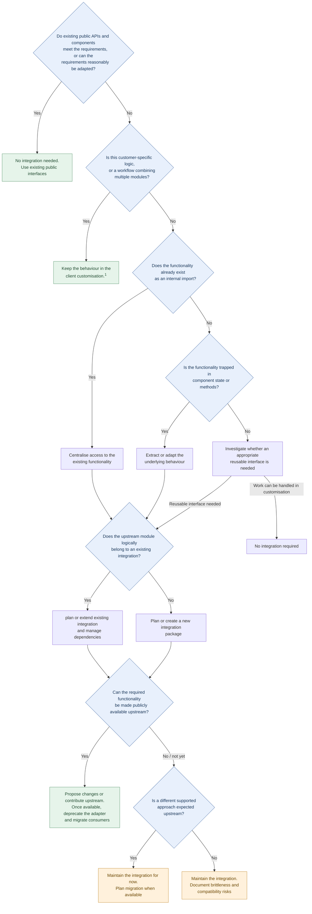

Designing an integration module
==============================

This document attempts to capture the design decisions behind the integration libraries currently and how we decide when to create a new integration library. Which modules belong together, what goes in the integration library vs remaining as public import, etc. It also aims to describe how to keep the integration packages maintainable as upstream changes.

This is not the place for proposing community standards (see [SUGGESTIONS](SUGGESTIONS.md)).

# When to create an integration

In the motivating example in the [README](README.md), the DepositBoxComponent needed for Chicago's implementation requirements needed to be a class component extension of the DepositBoxComponent in curations, as there was no way to get the behaviour required for that component without using the internal function implementations. This is one example of when it is best to create a middleware module to handle the _behaviour_.

I think about this question: "Do we need an integration package?" as a sort of flow diagram. This isn't necessarily intended as a strict process to follow, but as a starting point to thinking about whether something additional is needed, whether to wrap functionality, centralise exports or recreate internal methods, where all that should live and whether the requirements can eventually be met by an upstream public interface.



## <sup>1</sup> A note on cross-module workflows

Generally, customisations spanning multiple modules should be kept in the client customisation layer, as they specifically tie two otherwise disparate dependencies together. If the same workflow becomes useful across multiple customers, it may make sense to create a bridging module that's reusable. However, that would require a different set of considerations to these integrations, which instead aim to keep module logic composable and modular.

The aim is to avoid centralising customer behaviour, not to discourage reuse where it makes sense.

## Simplify where possible
 When a customer hits genuinely new requirements that look like they may require an integration, it may be best to develop said integrations in the manner described here, but to keep the code in the customisation at first, until such time as it's well tested. It may even be worth waiting until a second customisation needs the same functionality before extracting it, in order to understand how it may need to be generalised.

This additionally gives extra time to have upstream conversations, and potentially get the improvements directly into upstream _before_ needing to release, then deprecate a bespoke integration module.

This doesn't prevent writing that customisation code in a maintainable and reusable way from the outset though, so that future migration to a full integration is as seamless as possible.

## To extend or not to extend
When deciding whether it's better to extend a module vs creating a new one, it's best to prefer grouping functionality that belongs in the same upstream module or family of modules.

Two upstream packages could be independently installable but still belong to a strong enough group of functionality that it justifies grouping. Conversely, sharing dependencies or even multiple customers installing both modules doesn't necessarily mean they belong together.

## Contributing back
This set of documentation ([README](README.md), [SUGGESTIONS](SUGGESTIONS.md)) encourages making reusable functionality available through supported public interfaces, which may suggest opening upstream PRs for every integration or new functionality. However, that by itself is an entire lifecycle consideration, and shouldn't be considered a blocker for getting customer code written, tested and accepted. The recommendation is simply to discourage many customisation developers working in isolation of each other and solving similar problems in a myriad of brittle ways. 

Wherever practical, upstream issues or conversations should be a part of integration work, in particular when the integration is most brittle, such as reliance on internal implementation details. However, upstream acceptance shouldn't block progress, delivery and testing for customers. There _should_ be open lines of communication and dialogue, but it shouldn't grind all progress to a halt under the weight of a bureaucratic system.

# Integration boundaries
The integration packages should generally follow the boundaries of whatever upstream dependencies they're integration with/for. For example `@cottagelabs/invenio-integrations-rdm` handles access to base RDM functionality (anything included in the _base_ RDM install), while `@cottagelabs/invenio-integrations-curations` handles functionality provided by the extension [invenio-curations](https://github.com/tu-graz-library/invenio-curations).

This doesn't necessarily mean one integration per python invenio package/extension. Closely related packages can share an integration where they represent a closely knit bundle of functionality. For more information see [To extend or not to extend](#to-extend-or-not-to-extend).

Where one integration depends on functionality from another integration, their integration packages should declare that dependency explicitly. However, functionality shouldn't be duplicated or dependences made bidirectional, otherwise contributing back to the community might turn the entire invenio stack into one monolith.

# What belongs in an integration

When it comes to choosing what should go into an integration and what shouldn't, there are a few guiding examples and categorisations, listed below. This table is not a definitive set of rules, rather guideliens to help developers make educated decisions. At the end of the day if it's justifiable to include or exclude something then so be it, so long as it's documented.

| Belongs in an integration                           | Stays in a customisation                          |
|-----------------------------------------------------|---------------------------------------------------|
| Reusable hooks exposing upstream behaviour          | Customer specific validations                     |
| API clients and operation wrappers                  | Customer workflow sequences and tweaks            |
| Wrappers around unavoidable internal imports        | Custom page layouts/branding                      |
| Necessary exports not available through public APIs | Import of components already exposed through public exports |
| Reusable types/constants associated with interfaces | Extended vocabulary specific to one institution   |

Where possible, prefer exposing or adapting the underlying implementations rather than copying entire upstream components. The aim is to make behaviour available for customisations, not maintain a parallel implementation of something that already exists.

Clients should remain free to make decisions on how _their_ implementation of invenio should behave, such as a requirement to select a community before submitting for curation. That logic belongs in the client code rather than in anything central. However, the packages may provide centralised imports or versions of internal logic that allow such behaviour while the upstream implementation prevents that.

# Managing imports

Public Invenio imports are not necessarily independently installable npm interfaces. The differences are described in the ["levels of modularity" in the README](README.md#levels-of-modularity)

Sometimes a module has fantastic pre-built components that already do everything a customisation requires, but those components are only available bundled into some _other_ public export, keeping modularity low. 

In those cases, adding a single public import location can help deliver multiple customisations with minor differences in behaviour, and allowing them to be maintained together while the implementation remains private.

Migrating away from this would then follow a sequence like the following (indicative, not definitive)

1. Customisations import through the integration package
2. The functionality is exposed publicly
3. The existing integration export changes to forward the public one, with a deprecation notice
   1. The public export could change contracts compared to the integration version
   2. In that case, it is either a breaking change _anyway_ and should deprecate then direct consumers to upgrade with documented migration steps
   3. Or it could adapt the changes to the public one immediately, then deprecate with a warning that migrations will be needed when swapping in consuming code.
4. Consuming code changes over to the public import instead when convenient.

These packages aim to fill gaps where required, not become a secondary source of truth.

Finally, design decisions belong to the module author, if an integration developer wishes to use an internal context which is _deliberately_ left unexposed to the public, then this represents an unsupported use of the API. We should attempt to understand the decision made upstream before relying on it. Differences of opinion can happen, but in general it's best that ownership of relied on interfaces belong with the modules responsible for them.

That doesn't prevent the creation of functionality in a centralised integration, but it will likely always remain brittle and harder to maintain. If it's a genuine gap in necessary functionality then a ticket to address that gap in a way the module developers see fit is an alternative way to eventually migrate away from the integration work done in the meantime. 

# Dependencies and runtime requirements

## NPM dependencies

An integration should declare all packages it requires to function, including peer dependencies when the consuming application supplies a compatible shared interface.


As a general rule:
- Use `dependencies` for libraries the integration uses internally and can manage itself
- Use `peerDependencies` where the consuming application must provide a compatible shared dependency
  - Examples might include React or another library whose instance must be shared (`react-dom`, `redux`).
  - `react-invenio-forms` may not need to be a peer dependency simply because Invenio installs it. We should consider whether multiple versions could introduce differing HTTP behaviour.
  - General question: Does the consumer need to supply this package, share its runtime instance, or does the integration simply need its functionality?
- Use `devDependencies` for development, testing and build tooling.

For example, two separate integrations may decide to use TanStack Query internally. If they manage their own request state, and require their own provider, they can declare it in the `dependencies` block and expose public hooks or operations without expecting consumers to understand that it's in use. They must, however, ensure that their providers and hooks are configured so that they use the intended QueryClient. Simply declaring separate dependencies or nesting providers doesn't achieve this.

If the integrations _need_ to share a QueryClient (in this example), this becomes a requirement above the integrations. In that case, `peerDependencies` may be appropriate, but the required setup to enable the integrations must be documented.

NOTE: In theory this could take the form of a package that sits above a suite of integrations, `@cottagelabs/invenio-integrations-core` for example, and the affected integrations could _require_ this as a peer dependency. That allows for an ecosystem within the integrations space parallel to invenio itself. Such a dependency must be carefully managed though, it provides a simple way to accidentally introduce coupling between what are supposed to be disparate integrations. Thoughtful design of the eventual APIs is still required to keep everything modular.


What the above indicates is that a Provider managing state that's specific to a given integrations reasonably belongs to that integration. However providers intended to coordinate multiple integrations or application-wise state should probably sit at the application level. Shared infrastructure in integrations should be introduced cautiously. 

The important thing to take away is that NPM dependency declarations manage the installation of packages and version compatibility, but don't automatically configure relevant providers or guarantee that there will be compatible runtime instances (think multiple versions of `react-router-dom` for example).

Where possible, a consumer should be able to use an integration without having to do any manual configuring for all of its internal dependencies. Where specific providers are needed, a single integration provider may simplify the implementation.
```jsx
<CLIntegrationsRDMProvider>
  <CustomDepositForm />
</CLIntegrationsRDMProvider>
```

## Invenio frontend runtime

These integrations are designed for use within the existing Invenio frontend environment and aren't necessarily portable to an independently mounted or bundled applications.

Some functionality within an integration may rely on Invenio's webpack configuration, particularly the `@js` import path, or existing React contexts like `Formik` or `Redux`.These dependencies may not be expressible through the NPM packages, but should be documented where relevant.

## Python/Invenio backend compatibility
NPM cannot declare version compatibility with installed Invenio python packages, so the design chosen is a supported backend version matrix in the `package.json`, a field called `invenioCompatibility`.

The consuming Invenio installation runs `validate_toolkit()` (available currently in Chicago-specific code, but should be a public python package) to compare the installed Python package versions against the requirements declared by a given package. Should those requirements not match installed versions, the build fails loudly.

This is intended to catch incompatibilities, including legitimate breaking change versions sneaking into the build, or known incompatibilities due to changing internal implementation details being declared upfront. This should help upgrading and updating customers as a noisy verification step that things _should_ work as intended.

See [Versioning and upstream compatibility](#versioning-and-upstream-compatibility) for how these declarations are maintained between releases.

## Current Webpack integration
The integrations are they currently stand are developed as local NPM packages within Chicago's Invenio customisation. They are then registered as dependencies of the Invenio frontend through WebpackThemeBundle.

In Chicago's webpack.py this looks like
```python
theme = WebpackThemeBundle(
    __name__,
    "assets",
    default="semantic-ui",
    themes={
        "semantic-ui": dict(
            entry={
                # Chicago-specific entry points
            },
            dependencies={
                "@cottagelabs/invenio-integrations-rdm":
                    "file:./js/cl-invenio-integrations-rdm",
                "@cottagelabs/invenio-integrations-curations":
                    "file:./js/cl-invenio-integrations-curations",
                # Other frontend dependencies
            }
        ),
    },
)
```

The file: dependencies allow the application to make use of the locally maintained integration packages as if they were public NPMs. The intent is to eventually release them as such.

### Backend compatibility validation
Before constructing the bundle, some python code validates the installed backend dependencies against the declared `invenioCompatibility` field in each integration's package.json.

```python
validate_toolkit(CURATIONS_TOOLKIT_DIR)
validate_toolkit(RDM_TOOLKIT_DIR)
```

This compares the toolkit (integration) version and the backend package version for each declared package compatibility to see if they fit within the accepted ranges.

This fails _open_. Non declared packages are _not_ incompatibilities.

### Current implementation limitations

The compatibility validation mechanism is currently implemented within the Chicago site webpack implementation rather than as a standalone python package. The intention is to make that available to other implementations without requiring each integration to maintain its own copy.

There are a few limitations to the current approach. The immediate aim is to make dependencies more explicit and provide incrementally better handling of incompatibilities as they crop up, making explicit what are currently handled as brittle and undeclared dependencies.

### Validation is tied to the Webpack configuration
The current implementation calls `validate_toolkit()` when `webpack.py` is imported, before constructing the theme bundle. This means validation is part of loading that configuration rather than an explicit build step.

### Only declared backend dependencies are checked
The validator compares `invenioCompatibility` declarations against the installed Python packages. It does not validate the NPM package dependency compatibilities (leaving that to the Invenio webpack bundle), React context availability or any other frontend runtime requirements. These are left to the individual integrations at present.

## All declared backend dependencies are _required_
Optional backend dependencies are not currently supported.

### Compatibility is declared
It is up to regression testing in a given integration to make changes to declared compatibilities, that is not automated. It can give a helpful hint when an incompatibility is found, but is not a full safety net.

### Compatibility isn't back-portable
Updating a compatibility restraint in a newer integration release does not affect the previously released versions. Consumers must update their integration version to get the compatibility notice.

### Validation requires explicit integration
The consuming application's webpack config needs to locate each integration package and call the validator. This could eventually be centralised.

# Versioning and upstream compatibility

Each integration is versioned independently using semantic versioning. The `invenioCompatibility` field in `package.json` declares which versions of the upstream Python packages it supports.

Because some integrations depend on internal Invenio code rather than public APIs, upstream changes can break things without a major version bump. We deliberately restrict supported versions so builds fail early rather than allowing potentially broken integrations through.

## Historical and future compatibility mappings
Rather than declaring only the versions supported by the current toolkit release, `invenioCompatibility` can also describe past and future compatibility.

This serves mainly as developer guidance, someone inspecting the latest version of the integration can see which toolkit versions are appropriate for different upstream releases, without having to trawl through historical releases.

This also allows known incompatibilities to be documented before a replacement toolkit version is available. For example, if an upstream release requires changes that will be addressed in toolkit 2.0.0, the mapping can indicate that requirement before 2.0.0 has been released.

## When upstream releases a new version

- **If it's compatible**, verify it and release a patch (e.g. `1.0.1`) extending the supported version range.
- **If it breaks the integration**, release a patch (e.g. `1.0.2`) restricting the existing range and documenting which toolkit version will support the new upstream release.
- **If fixes are needed**, release an updated integration. Use a major version (e.g. `2.0.0`) if the integration's public API or supported compatibility contract needs to change. Otherwise, a patch or minor release may be enough.

## Correcting compatibility declarations

Compatibility declarations may be corrected in patch releases, including narrowing a previously supported compatibility range when a breaking change is discovered.

For example, if `invenio-rdm-records 21.3.4` breaks an integration at `1.0.0` previously supporting all of `21.x`, we can restrict toolkit `1.0.1` to `<21.3.4` and release toolkit `2.0.0` with the required changes.

This is intentional, if an integration declares support for an upstream version that turns out to be incompatible, that incompatibility exists regardless of the existing versions declaring it does not. Releasing a patch is a _correction_ of that relationship and prevents future customers from unknowingly installing an incompatible combination.

For example, if toolkit 1.0.0 declares compatibility with Curations 0.6.5, but that version is later found to be incompatible, toolkit 1.0.1 could restrict its supported range to <0.6.5.

Existing customers can then decide how to deal with this. They could remain temporarily on their existing toolkit release (if the incompatibility doesn't affect them, or affects in an acceptable way to not block release etc), downgrade the upstream dependency, or upgrade to a newer compatible toolkit when available. This is an explicit tradeoff vs the previous behaviour, which had similar tradeoffs, but could possibly be missed entirely and avoid needing the conversation.

## Picking up new compatibility relationships

Existing releases won't automatically pick up new compatibility rules, so consumers must update their integration packages to benefit from these checks. For example `1.0.2` could narrow the specified compatibility declared vs `1.0.1`. This means that always updating to the most recent patch version of an integration is the most likely workflow to keep the versioning checks live and functioning. Given the recommendations for versioning above, a caret `^` or `~` dependency is likely the best way to keep a customer's build as protected and verified as possible.

The aim is to catch upstream incompatibilities during the build and handle them in one place, rather than discovering and fixing the same problems separately in each client implementation.
