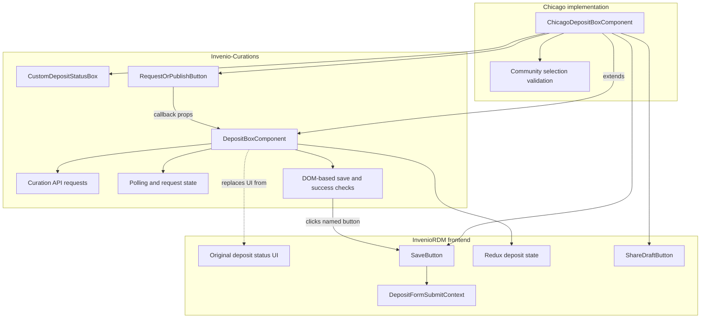
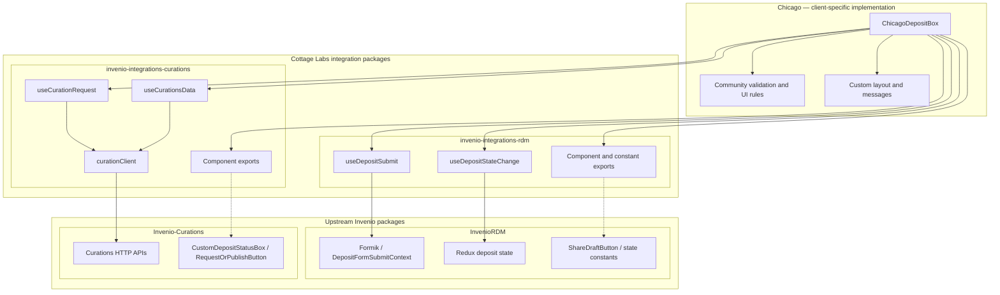

# Cottage Labs Invenio Integrations | Core

This is the core repository for all of Cottage Lab's attempts to centralise package logic, behaviour and imports for the Invenio frontend ecosystem. This currently consists of:

- @cottagelabs-invenio-integrations-core
    - Currently just this README, as a central place to store idea
- @cottagelabs/invenio-integrations-rdm
- @cottagelabs-invenio-integrations-curations

# Philosophy

## Invenio Context

The Invenio community, and in particular InvenioRDM appears to be a growing collection of developers all working to create bespoke behaviours for institutions which override or extend the basic ideas laid out by Invenio and InvenioRDM specifically. Each of these include flask python backend additions, as well as some collection of template, component and page overrides in React. This fosters fantastic creativity and a whole host of exciting additions to the core Invenio experience (s), but at present there doesn't appear to be a coherent structure in place to allow these to stack together and build off each other.

Invenio supports multiple ways of customising the frontend experience, giving a lot of freedom to the frontend implementors for each institution. These include (roughly in order of least - most involved):

- CSS overrides
- React component prop tweaks (parametrize)
- React component overrides (individual)
- Jinja template reworks
- Full React page overrides
- Entire DOM tree injection

## Motivating example

The motivating example behind these packages for me was seeing how invenio-rdm interacted with invenio-communities and invenio-curations. Curations is an add on module developed primarily for TU Graz University and then made available as an add on for other invenio installations to use. This add on contains some really useful additions and innovations on top of the built in RDM model.

Invenio is an open source community, which means that generally (and arguably, at least locally, correctly) the features that get prioritised are the ones which deliver working functionality to the end users. For independent additional modelling on the backend these can generally be combined at will, or at least with minimal additional interference. The focus on the frontend, however, is often to get the feature delivered to the end user, which in the example of the Deposit form for Cottage Lab's Chicago implementation required overrides of a given component from InvenioRDM, which extended a component taken from Curations. This React component contained all of the client logic for dealing with the curations API, but did not directly surface override "slots", and didn't interact with Invenio's "communities" feature in the way the customer wanted.

That leads to this overflowing diagram of concerns.

<TO BE CONTINUED>

## Where these integrations fit in

@cottagelabs/invenio-integrations-* aims to temporarily fill that gap. The packages do not aim to create and share custom components (yet) or define behavioural logic where two integrations overlap, instead it aims to encapsulate the behaviours and logic for each individual module and extension into a single place, so that any given implementation can take the underlying ideas behind
_any_ extension and use them independently OR alongside others.

## The future

<TO BE CONTINUED> Gold, silver, bronze standard for modularity and extensibility, etc etc?