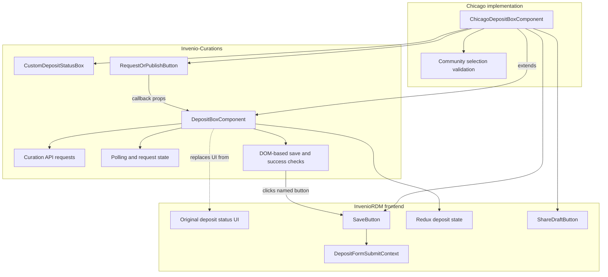
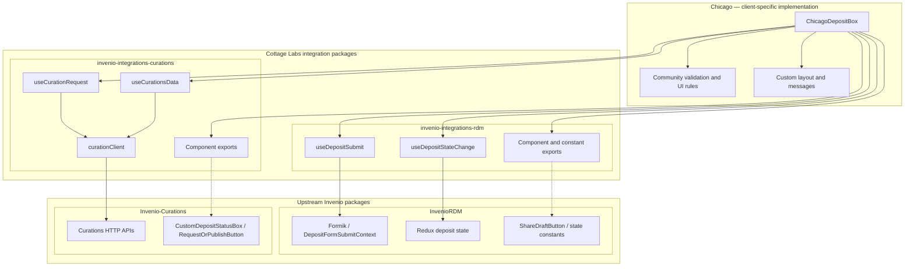
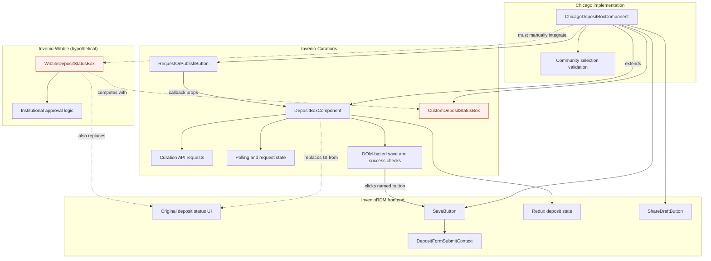
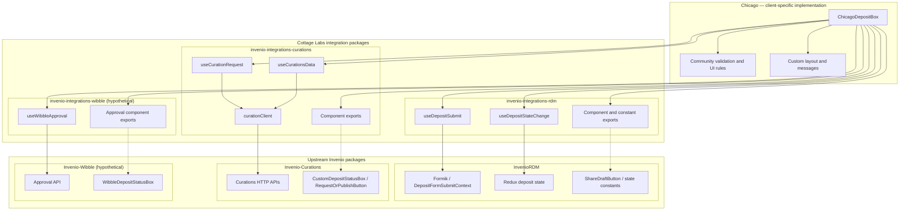

Cottage Labs Invenio Integrations | Core
========================================

This is the core repository for all of Cottage Labs' attempts to centralise package logic, behaviour and imports for the Invenio frontend ecosystem. This currently consists of:

- @cottagelabs-invenio-integrations-core
    - Currently just documentation, as a central place to store ideas and design philosophies
- @cottagelabs/invenio-integrations-rdm
- @cottagelabs-invenio-integrations-curations


NOTE: Diagrams below are largely created with AI right now and reviewed by me, but all words are my own.

# TL;DR
The dream is for Invenio's frontend to become an interconnected community of developers all working together to lift each other up.

A development team could in theory jump in and start developing customisations directly, without _needing_ to contribute back to the project, but with strong guidelines would be able to help find and report, and then maybe fix, areas where the community modules don't quite fit with the standards set.

This document is more of a philosophical take on why this might be needed and how it might fit together. For specific design choices made right now see the [DESIGN](DESIGN.md) file.

# Current Implementation
Before we jump into why these patterns and the ideas behind them, it's worth mentioning that currently this implementation of `@cottagelabs/invenio-integrations-core` simply houses 3 documentation files, referenced throughout this README, and then there are two integrations `@cottagelabs/invenio-integrations-rdm` and `@cottagelabs/invenio-integrations-curations`, which currently sit within the implementation for Chicago's Invenio customisation. Eventually these should be released as public NPM libraries.

These packages run inside Invenio's frontend environment, subject to some compatibility requirements on the python backends, documented in more detail in the [DESIGN document](DESIGN.md#versioning-and-upstream-compatibility).

# Invenio Context

The Invenio community, and in particular InvenioRDM appears to be a growing collection of developers all working to create bespoke behaviours for institutions which override or extend the basic ideas laid out by Invenio and InvenioRDM specifically. Each of these include flask python backend additions, as well as some collection of template, component and page overrides in React. This fosters fantastic creativity and a whole host of exciting additions to the core Invenio experience (s), but at present there doesn't appear to be a coherent structure in place to allow these to stack together and build off each other.

Invenio supports multiple ways of customising the frontend experience, giving a lot of freedom to the frontend implementors for each institution. These include (roughly in order of least - most involved):

- CSS overrides
- React component prop tweaks (parametrize)
- React component overrides (individual)
- Jinja template reworks
- Full React page overrides
- Entire DOM tree injection

Invenio's greatest strength is the ability to give individual implementations exactly what they're looking for, but unfortunately flexibility is always a tradeoff. Flexibility for a development ecosystem often means _less_ flexibility for implementation, and vice versa. The key is in finding the balance that can not stifle creativity while maintaining strong guidelines for reusable content that allow the flexibility to be passed on to _implementing_ developers, who can then build off each other and help to build the entire system.

# Motivating example

The motivating example behind these packages for me was seeing how invenio-rdm interacted with invenio-communities and invenio-curations. Curations is an add-on module developed primarily for TU Graz University and then made available as an add-on for other invenio installations to use. This add-on contains some really useful additions and innovations on top of the built-in RDM model.

Invenio is an open source community, which means that generally (and arguably, at least locally, correctly) the features that get prioritised are the ones which deliver working functionality to the end users. For independent additional modelling on the backend these can generally be combined at will, or at least with minimal additional interference. The focus on the frontend, however, is often to get the feature delivered to the end user, which in the example of the Deposit form for Cottage Labs' Chicago implementation required overrides of a given component from InvenioRDM, which extended a component taken from Curations. This React component contained all of the client logic for dealing with the curations API, but did not directly surface override "slots", and didn't interact with Invenio's "communities" feature in the way the customer wanted.

That leads to this overflowing diagram of concerns.



The lack of override for components is a stumbling block, but by itself isn't an issue. The main problem is that this component represents the _only_ official way from the package to get this functionality. The required operations being embedded in the component, and then the component itself being non-customisable is a one-two punch preventing neat reuse and extension.

# Levels of modularity

An invenio module can offer functionality to other developers in multiple ways, and I think about that in terms of 5 levels of modularity.

These levels are designed to help a developer with the question "how can I use this", by breaking the problem down and describing the solution in terms of the exports offered by said module. It is worth noting that this does not attempt to dictate how a module should be designed and implemented internally. Higher levels should make reuse and integration across the ecosystem possible without removing the flexibility, customisation and ease of development offered by lower levels.

It's also important to note that one module may have level 0, 1 and 2 offerings, for example. Different interfaces or components may be exposed at different levels. In addition a higher level isn't necessarily better. A tightly integrated React component may be the right design for a purpose, not everything has to be overrideable and modular.

## Level 0 | "No independent access"

- Some functionality used by a module is simply not available for import. This is most likely because it's implemented as internal work on a class component, requiring then an extended class component in a customised extension to make use of it.
- This is the highest "risk" level of extension, and most likely to cause maintainability issues over time.
- ```javascript
  import { DepositBoxComponent } from "@js/invenio_curations/deposit/DepositBox";
  ...
  class ChicagoDepositBoxComponent extends DepositBoxComponent {
  ...
  render() {
    const { latestRequest, curationsData, communityError } = this.state;
    const { record, permissions, groupsEnabled } = this.props;
    ...
    return (
      ...
      <RequestOrPublishButton
        ...
        handleCreateRequest={async (event) => {
          if (!this.hasCommunitySelected()) {
            this.setState({ communityError: true });
              return;
            }
            this.setState({ communityError: false });
              this.handleSave(event);
              await this.fetchCurationRequest();
              await this.createCurationRequest();
         }}
         ...
      />
      ...
    )
    
  }
  ```
- It is worth noting that access and how it's being used are separate.
  - For example the level 0 example above would be a level 1 if it was being rendered as is, but because internal state, methods and props are used it's a level 0.
  - Likewise, even if the component was available as a public export, `import { DepositBoxComponent } from "@js/invenio_curations";`, the reliance on internal implementation details _keeps_ it at a level 0.

## Level 1 | "Internal access"

- This is where a lot of package components and functionality seems to be.
- This is most commonly seen in components which perform a given task and/or hook into existing functionality in the desired way, but are _only_ available through internal path imports
- These represent risks as they are _not_ technically part of the public API, meaning that they could shift or be removed in non breaking changes, but they are at least not necessarily in and of themselves internal implementation details
- ```javascript
  import { DepositFormSubmitContext } from "@js/invenio_rdm_records/src/deposit/api/DepositFormSubmitContext";
  ```
- Note that this example is a piece of functionality rather than a component. However it is available as an import, just an internal only one, which makes it level 1 allowing for modular composition in a customisation.

## Level 2 | "Public Invenio imports"

- This is a deliberate import designed to allow reuse in a customisation.
- ```javascript
  import { SaveButton } from "@js/invenio_rdm_records";
  ```
- This is a good aim for the project as a whole to make the base layer of composability.
- It allows a customisation to make use of individual components and functionality.
- Note though that this does _not_ make any statements about component overrideability etc.
  - The key to keeping the ability for Invenio to be easily customisable would be that, where sensible, components (and potentially slots above/below or left/right of it depending on flow) might be overrideable, to make insertion of tiny pieces of functionality possible without wholesale overrides.
  - Those would STILL benefit from the approach here however, as they would allow such small additions to hook into the existing state. 
- The other trap here is that this level relies on implicit build processes and dependencies.
  - If Invenio uses React 18 and the equivalent `react-router-dom`, then `curations` makes use of that, there are implicit dependencies that _may_ be caught at built time, or may simply end up with runtime failures.
  - Being able to declare peer and haerd dependencies is a key part of a well-designed NPM ecosystem.

## Level 3 | "Independent frontend package"
- Functionality is distributed as a standalone NPM package
- Dependencies and supported versions are declared in package.json allowing for package managers to find and highlight many incompatibilities before runtime
- Public API which is explicit and reliable
- These can still rely on React contexts, Redux, Formik or other application infrastructure, but should make those _explicit_ rather than assuming the context in which the package is being run.
- This does *not* necessarily mean it can run in a separate React tree or independently built frontend.
- The package can still require a compatible Invenio frontend, but any such requirements should be part of its declared contract rather than hidden assumptions about the build environment.

For example, potentially:
```javascript
import { useDepositRecord, useDepositSubmit } from "@invenio/rdm-records";

const CustomDepositActions = () => {
  const record = useDepositRecord();
  const { submit, isSubmitting } = useDepositSubmit();

  return (
    <button
      disabled={isSubmitting}
      onClick={() => submit(record)}
    >
      Save draft
    </button>
  );
};
```

The package exposes a supported interface and documents the shape of the data it returns and the behaviours it owns. However these hooks might still depend on the deposit form's existing Formik context, Redux store and submission providers.

This set of functionality is then reusable by components rendered inside the existing Invenio application, but not necessarily a new React application mounted in its own root.

  
## Level 4 | "Portable frontend tooling"
- The underlying functionality is entirely independent of Invenio's existing frontend build, component tree and application state
- A separate frontend could be created using its own framework, dependencies and bundler, and making use of level 4 functionality it could perform the same underlying operations. This could be an entire rewrite of Invenio's frontend, or just a brand new deposit form or other page, but it exists bundled entirely separately
- Importantly this doesn't mean that every single component needs to be portable. A well-designed NPM could have level 3 exports and level 4 underpinning hooks and functions, allowing the components to be used as is, but the API calls to integrate those components remaining agnostic to allow custom components to be built either inside _or_ outside the Invenio bundle.
- The existing Invenio frontend should ideally consume those same APIs, rather than having a separate implementation of the behaviour.


For example:

```jsx
import { DepositProvider, useDepositSubmit } from "@invenio/rdm-records";
import { createRoot } from "react-dom/client";

const CustomDepositForm = () => {
  const { submit } = useDepositSubmit();

  return <button onClick={() => submit()}>Save draft</button>;
};

createRoot(document.getElementById("custom-deposit")).render(
  <DepositProvider apiUrl="/api">
    <CustomDepositForm />
  </DepositProvider>
);
```

The key here is that `useDepositSubmit` makes use of the `<DepositProvider>`. One would already be provided by the Invenio built in frontend, but custom frontends could be created without having to redo that functionality, as above.

## Levels beyond 4
In theory we could go one step further, separating out pure logic from _any_ framework at all, not just Invenio's build processes. This could occupy a level 5, and at some nebulous point in the future _might_ be a positive thing to aim for, in a world where Invenio as a whole looks to pivot away from React to Angular, say. However this seems unreasonable to aim for for every module, certainly anytime in the near future, but is worth considering for any extensions which look to remain independent of react, for example Cottage Labs' `edges` module.

The first things _potentially_ worth handling there are API clients, as these could offer 3rd party clients and interfaces the ability to directly interface with Invenio for better interoperability, regardless of tech stack.

For example, a deposit client might provide:

```jsx
import { createDepositClient } from "@invenio/rdm-client";

const deposit = createDepositClient({
  baseURL: "/api",
  fetch: globalThis.fetch,
});

await deposit.saveDraft(record);
```

The client would still require a compatible backend and have to handle appropriate authentication, but it would no longer rely on `react-invenio-forms`, internal Webpack aliases, Redux or the existing React application context.


# Where these integrations fit in

@cottagelabs/invenio-integrations-* aims to temporarily fill that gap. The packages do not aim to create and share custom components (yet) or define behavioural logic where two integrations overlap, instead it aims to encapsulate the behaviours and logic for each individual module and extension into a single place, so that any given implementation can take the underlying ideas behind
_any_ extension and use them independently OR alongside others.


Where an extension has useful functionality hidden with a component the integration can attempt to separate that behaviour out into reusable hooks, clients, functions or other reusable interfaces, including Types (where relevant). The integrations can also offer internal-only imports through a centralised public export.

The intention is not to replace the source of truth or replace upstream functionality long term. It's to make existing functionality more accessible and modular so that client customisations can make use of it, while keeping all the workarounds and more brittle executions in one place.

This allows a customer customisation like Chicago to compose all the functionality it needs from several extensions without having to inherit every extensions component class hierarchy.



## Growing pains

It is not hard to imagine a scenario where a new extension, `invenio-wibble` pops up, with its own additions and workflows on top of the deposit form. Under the current paradigm, if the wibble package decided to implement in the same way as curations does then the Chicago implementation hits an issue. A class component can only extend one other class at a time, and the behaviour required may be locked behind two.



If instead the same scenario plays out in the world of Cottage Labs integration modules, instead the required behaviour gets neatly abstracted away into an integrations module (potentially still requiring some unsavoury implementation choices) and the Chicago customisation can then choose which behaviours to make use of and render.



## Integration limitations
These integration packages sit in a slightly awkward place with respect to the [levels of modularity](#levels-of-modularity) outlined in this document. They can provide a clean and stable interface to client customisations while relying on upstream functionality that does not yet meet required levels of modularity.

For example an integration may have
- Consumer facing: Approaching Level 3
  - NPM package
  - reusable hook API
- Underlying dependencies: Level 1 and/or 0
  - Internal Invenio imports
  - Application context used implicitly

This distinction matters because just because the internal dependency has been made available through this middleware as a published NPM does not automatically make the code portable or stable. The integration is still relying on internal choices, just centralising it so that multiple client customisations aren't all affected by any internal API changes.

The aim is to make these integrations easier to use and maintain today, while hopefully reducing the need for them as upstream interfaces become more modular, the end goal is for the design patterns to spread upstream and be codified in some way.

## Modular Deposit Form
In starting work on this set of ideas I came across something that appears to be aiming in a similar vein, [modular-deposit-form](
https://github.com/MESH-Research/invenio-modular-deposit-form).

That also talks about trying to create an ongoing ecosystem where frontend developers can work _together_ to try and invenio a better development experience in the long run. I think the ideas laid out there and here overlap slightly but are ultimately separate and compatible.

### Behaviour vs Configurability
modular-deposit-form focuses mainly on the ability to configure the _base_ react code in a much more programmatic way, avoiding
additional boilerplate and customisations required every time a particular customer wishes to have the order of the deposit form tweaked. It also has provisions to fork (and contribute back) components and make them individually more overrideable and customisable, so that every implementation can make customisations to the experience without extra difficulties.

These integrations modules are a slightly different slant on the same problem. They instead focus on aiming to make the underlying logics and behaviours extensible, public, and modular. In an ideal world, these integrations would over time become obsolete as the ideas defining them take root and spread.

Instead of wrapping existing functionality and working around design decisions fundamentally incompatible with each other, these integrations are a necessarily brittle way to separate out concerns, borrow implementation logic and deliver functionality.

modular-deposit-forms calls on developers to try and work within the spirit of customisation, though, and that's where these ideas overlap. If the Invenio community at large can agree on rough guidelines and paradigms then moving forward customisation can become less and less painful.

# The future

All of this at present sits in a strange middle ground. It allows Cottage Labs ourselves to go and implement many differing extensions, even those which are potentially incompatible with each other, in a more modular way. However, a lot of the required workarounds and not-best-practices remain. There are still choices locked into upstream dependencies that force questionable design onto the packages. Internal-only imports can change without being flagged as a breaking change, the use of redux as _internal_ state likewise, it's not handled via conventions or with extensions in mind.

The proposal is to initially perform the work required to keep the logic separated clearly centralised into these packages. This allows 10 institutions to have their own unique combinations of modules and for Cottage Labs to be relatively secure in the knowledge that any potential breaking changes can be patched once and safely transmitted to all customers in one fell swoop, keeping upgrades neat.

However, in the longer term, it would be fantastic to see some of these ideas and approaches codified into standards and guidelines for community modules, potentially creating gold, silver, bronze tier integration levels to incentivise module developers to meet community guidelines and to give independent contributors meaningful targets to help a community module hit in order to best serve the ecosystem.

Note: The language here is meant to be representative and should probably be tweaked before being spread more widely. These tiers don't have to represent just how modular the codebase for an extension is, rather taking that into account along with documentation, compatibility testing, accessibility, maintainability and component overrides, as a more holistic view of "how useable and extensible is this module?"

Some of these suggestions are expanded in the [SUGGESTIONS](SUGGESTIONS.md) document.