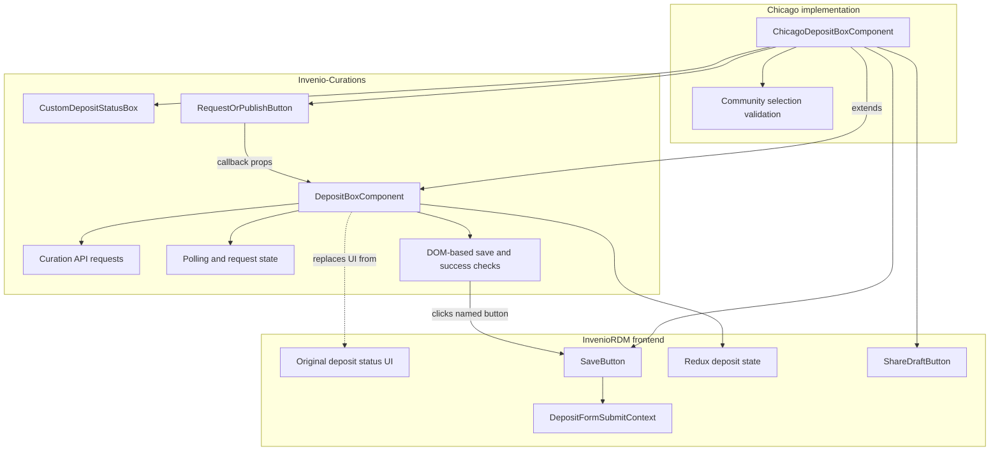
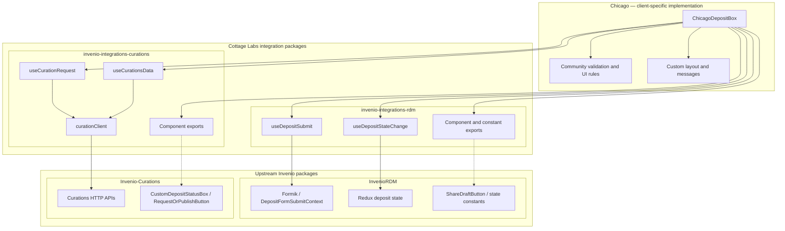
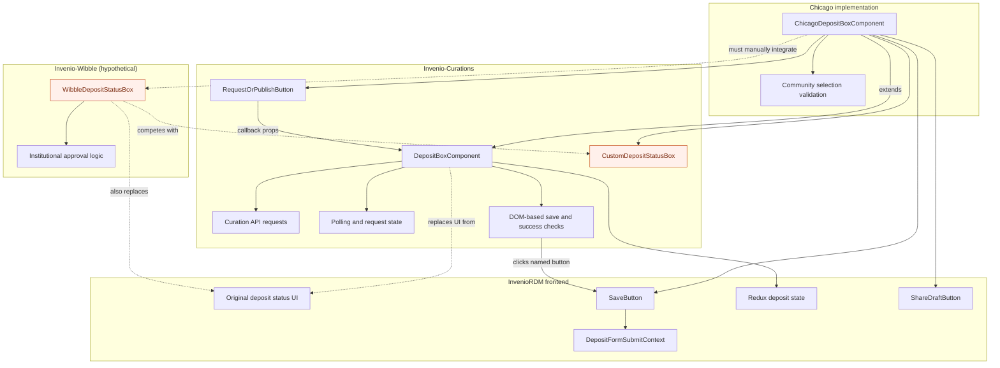
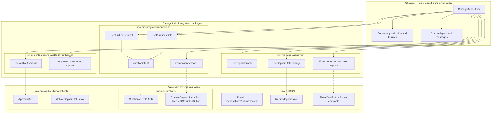

# Cottage Labs Invenio Integrations | Core

This is the core repository for all of Cottage Lab's attempts to centralise package logic, behaviour and imports for the Invenio frontend ecosystem. This currently consists of:

- @cottagelabs-invenio-integrations-core
    - Currently just this README, as a central place to store idea
- @cottagelabs/invenio-integrations-rdm
- @cottagelabs-invenio-integrations-curations

NOTE: Diagrams below are largely created with AI right now and reviewed by me, but all words are my own.

# Philosophy

## Invenio Context

The Invenio community, and in particular InvenioRDM appears to be a growing collection of developers all working to create bespoke behaviours for institutions which override or extend the basic ideas laid out by Invenio and InvenioRDM specifically. Each of these include flask python backend additions, as well as some collection of template, component and page overrides in React. This fosters fantastic creativity and a whole host of exciting additions to the core Invenio experience (s), but at present there doesn't appear to be a coherent structure in place to allow these to stack together and build off each other.

Invenio supports multiple ways of customising the frontend experience, giving a lot of freedom to the frontend implementors for each institution. These include (roughly in order of least - most involved):

- CSS overrides
- React component prop tweaks (parametrize)
- React component overrides (individual)
- Jinja template reworks
- Full React page overrides
- Entire DOM tree injection

## Motivating example

The motivating example behind these packages for me was seeing how invenio-rdm interacted with invenio-communities and invenio-curations. Curations is an add on module developed primarily for TU Graz University and then made available as an add on for other invenio installations to use. This add on contains some really useful additions and innovations on top of the built in RDM model.

Invenio is an open source community, which means that generally (and arguably, at least locally, correctly) the features that get prioritised are the ones which deliver working functionality to the end users. For independent additional modelling on the backend these can generally be combined at will, or at least with minimal additional interference. The focus on the frontend, however, is often to get the feature delivered to the end user, which in the example of the Deposit form for Cottage Lab's Chicago implementation required overrides of a given component from InvenioRDM, which extended a component taken from Curations. This React component contained all of the client logic for dealing with the curations API, but did not directly surface override "slots", and didn't interact with Invenio's "communities" feature in the way the customer wanted.

That leads to this overflowing diagram of concerns.

<TO BE CONTINUED>

## Where these integrations fit in

@cottagelabs/invenio-integrations-* aims to temporarily fill that gap. The packages do not aim to create and share custom components (yet) or define behavioural logic where two integrations overlap, instead it aims to encapsulate the behaviours and logic for each individual module and extension into a single place, so that any given implementation can take the underlying ideas behind
_any_ extension and use them independently OR alongside others.

### Growing pains

It is not hard to imagine a scenario where a new extension, `invenio-wibble` pops up, with its own additions and workflows on top of the deposit form. Under the current paradigm, if the wibble pasckage decided to implement in the same way as curations does then the Chicago implementation hits an issue. A class component can only extend one other class at a time, and the behaviour required may be locked behind two.

If instead the same scenario plays out in the world of Cottage Labs integration modules, instead the required behaviour gets neatly abstracted away into an integrations module (potentially still requiring some unsavoury implementation choices, mind) and the Chicago customisation can then choose which behaviours to make use of and render.

## The future

All of this at present sits in a strange middle ground. It allows Cotttage Labs ourselves to go and implement many differing extensions, even those which are potentially incompatible with each other, in a more modular way. However a lot of the required workarounds and not-best-practices remain. There are still choices locked into upstream dependencies that force questionable design onto the packages. Internal-only imports can change without being flagged as a breaking change, the use of redux as _internal_ state likewise, it's not handled via conventions or with extensions in mind.

The proposal is to initially perform the work required to keep the logic separated clearly centralised into these packages. This allows 10 institutions to have their own unique combinations of modules and for Cottage Labs to be relatively secure in the knowledge that any potential breaking changes can be patched once and safely transmitted toall customers in one fell swoop, keeping upgrades neat and tidy.

However, in the longer term, it would be fantastic to see some of these ideas and approaches codified into standards and guidelines for community modules, potentially creating gold, silver, bronze tier integration levels to incentivise module developers to meet community guidelines and to give independent contributors meaningful targets to help a community module hit in order to best serve the ecosystem.

Some suggestions might be (not comprehensive):
- Best practices for use of redux store
  - Namespacing
  - Read only when making use of another module's namespace
    - This would also of course require some kind of dependency statement
- API logic handling
  - Centralise conventions like "http" from react-invenio-forms somewhere more official
  - a module may hook into a central request state manager (react query?) OR bring its own
    - But if the latter should aim to add side effect hooks so that another module or implementor can hook into those requests
  - Public Typescript
- React render components
  - All react render components are overrideable
  - Potentially including some way to shift layouts for full page layouts (think "blocks" from Jinja)
  - Every component not only overrideable but renders its own overrideable and customisable container with slows above and below it (maybe a bit overkill, but could have react-invenio-verrideable to neaten that logic)
- Dependency management
  - Better declarations (somehow) of NPM hard dependencies, peer dependencies and potentially dev dependencies
  - I need a better understanding of how this works currently, but frontend components COULD be a new react tree for isolated dependencies or rendered inline, using the same deps. Care should be taken that things don't drift out of line.

<TO BE CONTINUED> Gold, silver, bronze standard for modularity and extensibility, etc etc? Talk about modular-deposit-form work and how these concerns overlap but are distinct.
